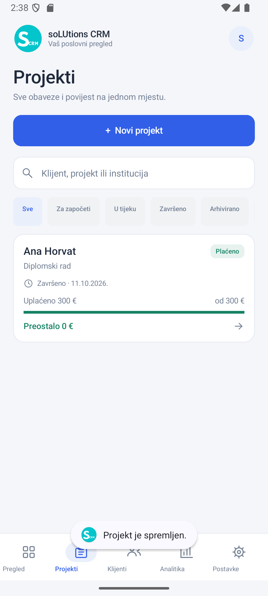
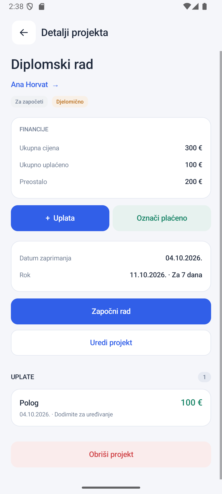
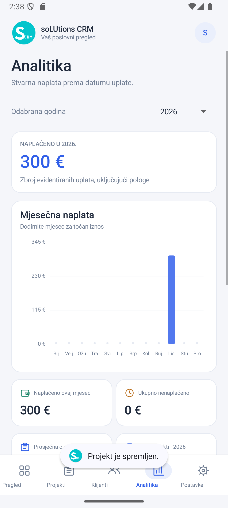

# soLUtions CRM

Izvorna Android aplikacija za jednog vlasnika obrta: projekti, klijenti, rokovi i stvarno zaprimljene uplate. Sučelje je na hrvatskom jeziku, s EUR iznosima i datumima `DD.MM.GGGG.`. Radi bez interneta i bez korisničkog računa.

## Pokretanje

1. Otvorite ovu mapu u Android Studiju kao Gradle projekt.
2. Koristite JDK 17, Android SDK 35 i Gradle wrapper koji je uključen u projekt. Android Studio može konfigurirati lokalni SDK kroz `local.properties`.
3. Pokrenite modul `app` na telefonu ili emulatoru s Androidom 8.0 ili novijim.

Izgradnja i provjere iz terminala:

```powershell
.\gradlew.bat assembleDebug testDebugUnitTest lintDebug
# Za instrumentacijske testove pokrenite emulator:
.\gradlew.bat connectedDebugAndroidTest
```

APK za probnu instalaciju: `app/build/outputs/apk/debug/app-debug.apk`. To je razvojna verzija potpisana debug ključem. Objavljivanje u trgovini zahtijeva vlastiti release ključ.

## Svakodnevni rad

- **Pregled:** aktivni projekti po rokovima, upozorenje za zakašnjele projekte, ukupan dug, naplata mjeseca, poslovi koji čekaju uplatu i tri posljednja završena i plaćena projekta.
- **Projekti:** svi projekti, pretraga i filtri po statusu rada, plaćanju, arhivi, kašnjenju i dugovanju.
- **Klijenti:** kontakti, institucija, zbirne vrijednosti i projekti pojedinog klijenta. Postojeći klijent može se pronaći tijekom unosa projekta.
- **Detalji projekta:** datum zaprimanja, rok, cijena, neovisni statusi rada i plaćanja, kronološke uplate, uređivanje i brisanje. `Označi plaćeno` evidentira završnu uplatu točno preostalog iznosa.
- **Analitika:** izbor godine, svih 12 mjeseci, graf i tablica stvarnih uplata, godišnji ukupni iznos, trenutni mjesec, nenaplaćeno i prosječna ugovorena cijena projekata iz odabrane godine.
- **Postavke:** tamni prikaz, JSON backup i vraćanje podataka, CSV izvoz uplata te vraćanje obrisanih projekata. MVP koristi hrvatski jezik i EUR; druge valute i prijevodi nisu uključeni.

Novi projekt dobiva današnji datum i status `TODO`. Rok je unaprijed predložen za sedam dana i može se promijeniti. Cijena može ostati prazna. Polog, ako je uključen, sprema se zajedno s projektom kao posebna uplata. Kod upisa već postojećeg imena i prezimena bez odabira prijedloga koristi se postojeći klijent; za razlikovanje istoimenih osoba koristite odabir prijedloga i instituciju.

## Poslovna pravila

Iznosi se čuvaju kao cijeli broj centi. `totalPaid` je zbroj uplata, `remaining` je `max(price - totalPaid, 0)`, a preplata se prikazuje zasebno. Nema ručno spremljenog statusa plaćanja.

Projekt bez cijene ima nepoznat financijski status; može imati uplate, ali se ne može brzo označiti plaćenim. Njegov nepoznati dug nije uključen u nenaplaćeno. Projekt čija je cijena 0 € smatra se financijski zatvorenim bez stvaranja fiktivne uplate.

Status `DONE` ne podrazumijeva da je projekt plaćen. U `DONE` se automatski upisuje datum završetka. Povratak u `TODO` ili `IN_PROGRESS` resetira taj datum. Arhiviranje skriva projekt s pregleda, ali njegov dug ostaje uključen u ukupno nenaplaćeno, a njegove uplate u analitiku.

Naplata pripada godini i mjesecu **datuma uplate**, ne datumu otvaranja projekta. Mjeseci bez uplata ostaju prikazani s 0 €. Prosječna cijena uzima definirane cijene projekata otvorenih u odabranoj godini.

Brisanje projekta je soft delete: projekt i njegove uplate ostaju u lokalnoj bazi, izuzeti su iz svih izračuna, a mogu se vratiti iz Postavki. Brisanje pojedinačne uplate nakon potvrde trajno je.

## Podaci i backup

Podaci su u internoj SQLite bazi `tracker.db`, odvojeni u tablice klijenata, projekata, uplata i postavki. Strani ključevi provjeravaju povezanost. Cijela promjena sprema se u jednoj transakciji, uključujući kreiranje klijenta, projekta i pologa. Neuspjela transakcija ostavlja prethodne podatke sačuvane.

JSON backup ima oznaku formata `project-payment-tracker`, verziju `1`, polja `clients`, `projects`, `payments` i `settings`, uključujući soft delete zapise. Novčana polja su `priceCents` i `amountCents`; datum rada i uplate u kopiji je ISO `YYYY-MM-DD`. Import provjerava format, datume, iznose, jedinstvene ID-ove i povezanost prije potvrde zamjene. Uvoz zamjenjuje cijelu bazu; nije spajanje podataka. Podržava kopije do 10 MB i 100.000 zapisa.

Datoteku odabire korisnik kroz Androidov sistemski dijalog. Backup je običan JSON i sadrži kontaktne podatke; odabrano mjesto pohrane i njegovo dijeljenje kontrolira korisnik. Aplikacija nema `INTERNET` dozvolu, a automatski cloud backup i sistemski prijenos baze su isključeni.

CSV je UTF-8 s BOM oznakom, separatorom `;`, decimalnim zarezom i stupcima Datum, Klijent, Projekt, Vrsta uplate, Iznos (€). Obuhvaća uplate projekata koji nisu obrisani, uključujući arhivirane projekte.

Izvoz i čitanje datoteka rade u pozadinskoj niti. Obrasci čuvaju nespremljen unos pri rekreiranju aktivnosti. Aplikacija se otvara s praznom bazom; nema unaprijed unesenih poslovnih podataka.

## Provjera

Provjereno na Android 15 / API 35 emulatoru, uključujući rekreiranje aktivnosti. Svih **29 testova** prolazi (14 JVM + 15 na uređaju). `assembleDebug`, `testDebugUnitTest`, `lintDebug` i `connectedDebugAndroidTest` prolaze.

- 14 JVM testova: iznosi, datumi, djelomične uplate, promjena cijene, nepoznata i nulta cijena, preplata, arhivirani dug, soft delete, godišnji prijelaz, rokovi, završavanje i pretraga.
- 6 instrumentacijskih testova: JSON round trip, ponovno otvaranje baze, rollback transakcije i odbijanje neispravnih kopija.
- 3 instrumentacijska testa korisničkih tokova: projekt s pologom do završne naplate, projekt bez cijene s naknadno definiranom cijenom, ponovno korištenje klijenta i uređivanje uplate.
- 6 dodatnih provjera na emulatoru: nacrt nakon rekreiranja aktivnosti, preplata i arhivirani dug, potvrda brisanja i vraćanje uplata, tamni prikaz i izbor godine, potvrda zamjene backupa te zapis JSON/CSV datoteka.

Testovi pohrane koriste zasebnu bazu. Testovi korisničkih tokova privremeno zamjenjuju podatke na testnom uređaju i vraćaju prethodno stanje u `tearDown`; pokrećite ih na testnom emulatoru. Android 8–14 pokriven je provjerom API kompatibilnosti, ali nije zasebno testiran na uređajima. Lint nema grešaka; preostala upozorenja odnose se na programatske prikaze i tekstove.

## Prikazi ekrana

Prikazi su snimljeni na emulatoru sa sintetičkim podacima:

Promijenjen naziv i prilagodljiva ikona dodatno su provjereni u Android launcheru. Ručno su provjereni unos s tipkovnicom i otvaranje Androidova dijaloga za izvoz sigurnosne kopije. Integracijski testovi zapisa datoteka koriste simulirani rezultat odabira datoteke; navigacija samim sistemskim dijalogom provjerena je ručno. U repozitorij su uključeni samo prikazi sa sintetičkim testnim podacima.

| Projekti | Detalji | Analitika |
| --- | --- | --- |
|  |  |  |

## Struktura

- `res/values/strings.xml`: naziv aplikacije **soLUtions CRM**.
- `res/mipmap-anydpi-v26/ic_launcher.xml`: prilagodljiva Android ikona; pozadina `#04C5CC`, bijeli monogram **S** i manji **CRM**.
- `Models.java`: klijenti, projekti, uplate i postavke.
- `Domain.java`: financije, statusi, datumi, pretraga i analitika.
- `Store.java`: transakcijska SQLite pohrana.
- `Backup.java`: JSON serijalizacija i validacija uvoza.
- `MainActivity.java`: native ekrani, obrasci i Android dokumentni dijalozi.
- `RevenueChart.java`, `IconView.java`: vektorski crtani graf i ikone.

Računi, fiskalizacija, bankovne integracije, cloud sinkronizacija i više korisnika nisu dio ove aplikacije.
